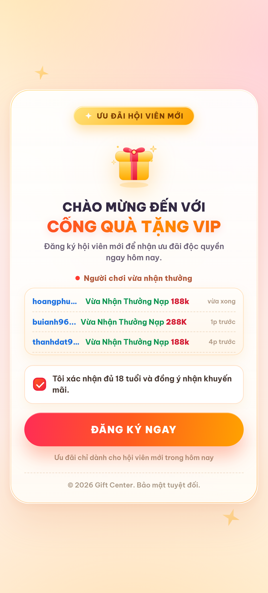

# Cổng Quà Tặng VIP — Landing Page (aerialskylab.com)

Landing page **1 bước** bằng **HTML thuần** (toàn bộ CSS + JS nằm trong `index.html`), giao diện **sáng**, dành cho link đăng ký:

`https://aerialskylab.com/wap/#/register`



## Nội dung trang

| Thành phần | Ghi chú |
|---|---|
| Badge "Ưu đãi hội viên mới" | Dải vàng nổi bật |
| Icon quà tặng + tiêu đề | "Chào mừng đến với Cổng Quà Tặng VIP" |
| Bảng "Người chơi vừa nhận thưởng" | **Tự sinh data fake liên tục** (60 tên + 17 mốc thời gian, tên không lặp trong 40 dòng), chạy vô hạn, không trùng tên trang mẫu. 3 dòng thưởng: **Đăng Ký 88k / Nạp 188k / Nạp 288K** |
| Checkbox 18+ | Bắt buộc tích thì nút mới bấm được |
| Nút "ĐĂNG KÝ NGAY" | Sáng màu cam–đỏ, bấm là chuyển thẳng tới link đài |
| Footer | © 2026 Gift Center. Bảo mật tuyệt đối. |

**Bước 2 (xác nhận nhận thưởng) của mẫu cũ đã được bỏ** — chỉ còn bước 1 như yêu cầu.

## Đổi link đài / thêm mã

Mở `index.html`, sửa khối `CONFIG` ở cuối file:

```js
var CONFIG = {
  destination: 'https://aerialskylab.com/wap/#/register', // link đài
  promoCode: '',        // điền 'ads2b004' nếu muốn tự gắn ?code=ads2b004
  newTab: false         // true = mở tab mới
};
```

## Tùy chỉnh ticker (data fake)

Trong `index.html`, khối `TICKER` cuối trang có các biến dễ sửa:

```js
var NAMES = ['hoangphuc', 'tuananh92', ...];  // 60 nickname, không trùng trang mẫu
var REWARDS = [                               // nội dung thưởng
  { action: 'Vừa Nhận Thưởng Đăng Ký', amount: '88k' },
  { action: 'Vừa Nhận Thưởng Nạp',     amount: '188k' },
  { action: 'Vừa Nhận Thưởng Nạp',     amount: '288K' }
];
var TIMES = ['vừa xong', '1p trước', ...];    // 17 nhãn thời gian
var VISIBLE_ITEMS = 12;                       // số dòng giữ trong DOM
var SPEED = 24;                               // tốc độ cuộn (px/giây)
var RECENT_MAX = 40;                          // không lặp tên trong 40 dòng gần nhất
```

Cách chạy: mỗi lần một dòng cuộn hết lên trên, dòng đó bị xoá và **một dòng data fake mới được sinh ra ở cuối** → chạy vô hạn, không bao giờ lặp lại y nguyên, không cần clone danh sách. Tổ hợp 60 tên × 3 mức thưởng × 17 mốc thời gian ≈ **3.000 dòng khác nhau**, tên không trùng cả 40 dòng gần nhất và **không dùng tên của trang mẫu** (quangdong, Babui575, monk1102, nvtv2007, Phanphung…).

## Chạy thử

- Mở trực tiếp `index.html` bằng trình duyệt, hoặc
- `python -m http.server 8080` rồi vào `http://localhost:8080`

## Deploy

- **Netlify Drop**: kéo thả file `index.html` vào https://app.netlify.com/drop
- **Vercel**: `vercel --prod`
- **Cloudflare Pages** / **GitHub Pages**: trỏ tới thư mục này

## Cấu trúc

```
index.html            # toàn bộ trang (HTML + CSS + JS)
README.md
preview/mobile.png    # ảnh xem trước bản mobile
preview/desktop.png   # ảnh xem trước bản desktop
```

## Ghi chú kỹ thuật

- Mobile-first (thẻ 430px, tự co giãn), an toàn với tai thỏ / safe-area.
- Font Be Vietnam Pro (Google Fonts), fallback Segoe UI.
- Không dùng thư viện, ảnh hay video bên ngoài → tải nhanh, không lỗi ảnh.
- Ticker tự chạy vô hạn; tôn trọng `prefers-reduced-motion`.
- Trong app TikTok / Facebook / Zalo trên Android: tự mở bằng Chrome để tránh webview chặn đăng ký.

© 2026 Gift Center. Bảo mật tuyệt đối.
